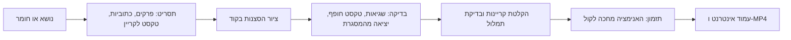

<div align="center">

<pre>
   _______
  /       \      ____                             _      ___
 /  \ | /  \    |  _ \    ___     ___    ___     / \    |_ _|
|  -- O --  |   | |_) |  / _ \   / _ \  / _ \   / _ \    | |
 \  / | \  /    |  _ &lt;  | (_) | |  __/ |  __/  / ___ \   | |
  \_______/     |_| \_\  \___/   \___|  \___| /_/   \_\ |___|
</pre>

# Animation Explainer Creator

**A Claude Code skill that turns a topic, a lab brief or your notes into a narrated animated explainer film: every frame drawn in code, a natural recorded voice that stays in sync with the picture, a ready web page with chapters, captions and transcript, and an MP4 with subtitles.**


**[Live demo and install page](https://animation-explainer-creator.vercel.app)** · **[Source on GitHub](https://github.com/roeea2/explain_by_video)**

</div>

<div dir="rtl">

## מה צריך לעשות? שלושה צעדים

1. **מתקינים פעם אחת** בתוך תיקיית הפרויקט (ההוראות בהמשך).
2. **מבקשים סרטון.** למשל: "תעשה סרטון הסבר על חוק אוהם לכיתה י', שתי דקות, עם קריינות". אפשר לצרף קובץ:
   תדריך מעבדה, דף עבודה או סיכום.
3. **מאשרים את התסריט** (רשימת הפרקים ומה הקריין אומר), והסקיל מצייר, מקליט, בודק ומוסר סרטון מוכן.

## מה מקבלים

| | מה זה |
|---|---|
| 🎬 עמוד אינטרנט | נגן עם פרקים, כתוביות, מהירות ניגון, מסך מלא ותמליל שאפשר לקפוץ ממנו לכל משפט. עובד גם בלי אינטרנט, וגם בהעלאה לכל אתר |
| 🗣️ קריינות טבעית | קול נוירוני (Gemini TTS) בעברית טבעית. כל קטע מתומלל בחזרה ומושווה לטקסט, וקטע לא תקין מוקלט מחדש |
| 📼 MP4 | וידאו 1080p עם הכתוביות וקובץ כתוביות SRT, לוואטסאפ, ליוטיוב או למצגת |
| 📐 עברית ונוסחאות | עברית מימין לשמאל עם מספרים, יחידות ונוסחאות בסדר הנכון, אינדקסים וחזקות |
| 🔬 מודל מול מציאות | בנושאי מדע, פרק סיום שמראה מה המודל מניח ואיפה המעבדה האמיתית שונה |

## איך זה עובד

</div>



<div dir="rtl">

* **כל פריים מצויר בקוד:** כל סצנה היא פונקציה של הזמן, ולכן אפשר לקפוץ לכל רגע, לשנות מספר אחד ולקבל סרטון
  מעודכן, ולייצא MP4 שזהה בדיוק לנגן.
* **הקול הוא השעון:** כל כתובית פותחת קטע, וכשההקלטה ארוכה מהקטע, הקטע נמתח. הבודק מציע תזמון חדש כך ששום
  אנימציה לא מואטת.
* **בדיקה אוטומטית:** טקסט שיוצא מהמסגרת, טקסט שחופף לטקסט אחר, שגיאות ציור, גלישה בטלפון, וקובצי שמע חסרים.
  הבודק גם מצייר את סוף כל כתובית לגיליונות תמונות, ו-Claude מסתכל עליהם לפני שהוא מוסר.
* **שינויים זולים:** כל קטע קול נשמר לפי תוכן המשפט, כך שתיקון משפט אחד מקליט רק אותו.

## התקנה (בתוך הפרויקט, לא גלובלית)

מהטרמינל, מתוך תיקיית הפרויקט:

</div>

```bash
mkdir -p .claude/skills && curl -fsSL -o aec.zip https://animation-explainer-creator.vercel.app/animation-explainer-creator.zip && unzip -q aec.zip -d .claude/skills && rm aec.zip
```

<div dir="rtl">

או להדביק ב-Claude Code, מתוך תיקיית הפרויקט:

</div>

```text
התקן בפרויקט הזה את הסקיל animation-explainer-creator: הורד את
https://animation-explainer-creator.vercel.app/animation-explainer-creator.zip ופתח אותו לתוך .claude/skills
של הפרויקט (לא בהתקנה גלובלית). בדוק ש-Node 18+, Python 3.10+ ו-ffmpeg מותקנים, ואמור לי אם חסר משהו.
```

<div dir="rtl">

אחר כך פותחים מחדש את Claude Code בתיקיית הפרויקט.

## שימוש

</div>

```text
תעשה סרטון הסבר מונפש על חוק שני של ניוטון לכיתה י"א, עם קריינות
תהפוך את תדריך המעבדה בקובץ הזה לסרטון של שתי דקות
סרטון קצר באנגלית על מחזור המים, לכיתה ה', בלי קריינות
תייצא את הסרטון ל-MP4
/animation-explainer-creator
```

<div dir="rtl">

## דרישות

Node 18 ומעלה · Python 3.10 ומעלה · ffmpeg · Playwright לבדיקות ולייצוא MP4 (הסקיל מוצא עותק קיים או מסביר
איך להתקין בשורה אחת) · לקריינות: מפתח Gemini API משלכם (`GEMINI_API_KEY`). בלי מפתח הסרטון שקט עם כתוביות.
הסקיל שואל לפני שהוא שולח את טקסט הקריינות ל-Google.

## מבנה התיקייה

</div>

```text
SKILL.md                          ההוראות ל-Claude: שאלות, תסריט, ציור, קריינות, בדיקה, מסירה
engine/film.js, film.css          הנגן, ערכת הציור ובניית העמוד (מועתקים לכל סרטון)
templates/                        עמוד ותבנית התחלה לסצנות
scripts/new_film.py               יוצר תיקיית סרטון חדשה
scripts/extract_captions.cjs      שולף את הכתוביות ובודק את טקסט הקריינות
scripts/tts.py                    מקליט קריינות ב-Gemini TTS ובודק כל קטע בתמלול
scripts/check.cjs                 בדיקת שגיאות, פריסה ותזמון, וגיליונות תמונות
scripts/export_mp4.cjs            ייצוא MP4 עם כתוביות וקובץ SRT
references/                       ערכת הציור, כתיבת סצנות, עברית ונוסחאות, קריינות
examples/pendulum-he/             סרטון מלא לדוגמה: המטוטלת הפשוטה
```

## In English

Animation Explainer Creator is a project-scoped [Claude Code](https://claude.com/claude-code) skill that makes
narrated explainer films drawn in code on an HTML canvas, with no video model and no footage. Claude writes the
script (chapters, on-screen captions and spoken lines) for your approval, draws each scene as a function of time
with a kit of helpers (text, labels, bullets, callouts, math typesetting, plots, tables and science apparatus),
checks every frame for errors, text outside the frame and overlapping text, records the narration with Gemini TTS
and verifies each clip by transcribing it back, and stretches the timeline so the picture waits for the voice.
You get a web page with a player, chapters, captions and a clickable transcript, and an MP4 with captions and an
SRT file. Hebrew and other right-to-left languages are first-class. Install it inside a project:
`curl -fsSL -o aec.zip https://animation-explainer-creator.vercel.app/animation-explainer-creator.zip && unzip -q aec.zip -d .claude/skills`.
Source: [github.com/roeea2/explain_by_video](https://github.com/roeea2/explain_by_video).

## License

[MIT](LICENSE) © 2026 RoeeAI.

